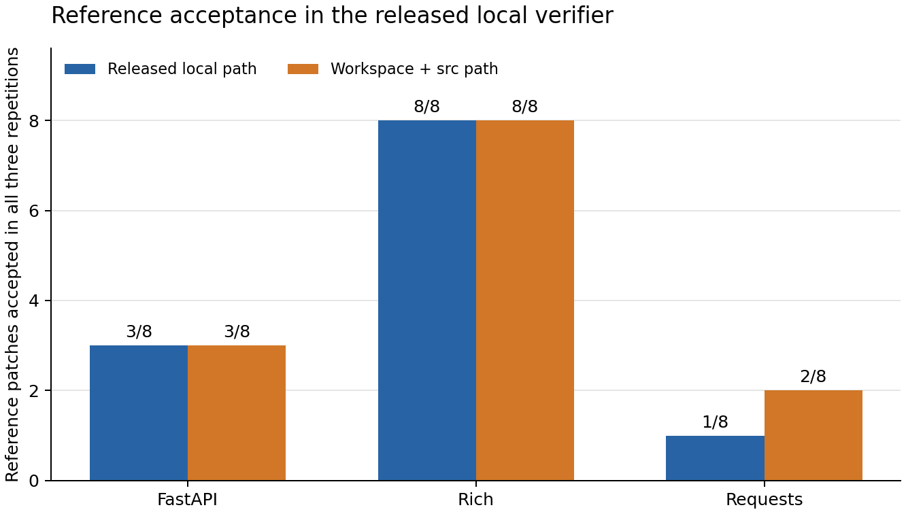

# Before Scoring the Agent

## Auditing Gemma 4's Local Verifier

**Author:** Akadri Oluseyi

**Paper:** *Reference-Patch Acceptance in the Released Gemma 4 Local Verifier*

[Read the paper PDF](before-scoring-the-agent.pdf) · [Read the Markdown paper](paper.md)

This paper reports a preregistered audit of the released local subprocess
verification path, using 24 software-repair tasks and 288 controls. The released
condition accepted reference workflows on 12 tasks; a fixed source-path change
increased acceptance to 13. All repetitions agreed within each task and condition.

Released Requests base/reference verdicts were identical on all eight tasks,
alongside probes resolving to the system-installed package. This limits
attribution to the supplied patches. The evidence concerns the instrumented
local workflow on one pinned image, rather than model coding accuracy or the
hidden competition scorer.

## Publication bundle

- `before-scoring-the-agent.pdf`: the reviewed paper rendered as a PDF.
- `paper.md`: the reviewed manuscript text.
- `reference-acceptance.png`: the study's aggregate reference-acceptance figure.
- `thumbnail.png`: the 560 × 280 project cover illustration.
- `paper/supporting-evidence.json`: configuration, split-identity and released-source checks.
- `release-manifest.json`: artifact hashes and export provenance.

This is a paper and figure publication bundle. The research code and execution
bundle remain private; reproduction requires authorized competition access.
Raw task records, reference patches, test source, traces and credentials are
excluded from this release.

Preregistration: `52e0030deb8312c1c1d8abe804abfa6dbc2ae75b`.
Registered results: `dafa6a7c41aae0856593063e88b3f498eeaff837`.
Supplemental provenance: `c68a0ee2a9ec6ae486acd9f5a9145f54039a0d85`.
Reviewed source snapshot: `968ddd6dcf0771b6392476cf21cc35fb15c8594e`.

The thumbnail is an AI-generated editorial illustration, not a data plot.
The results figure is derived from the recorded control outcomes.
