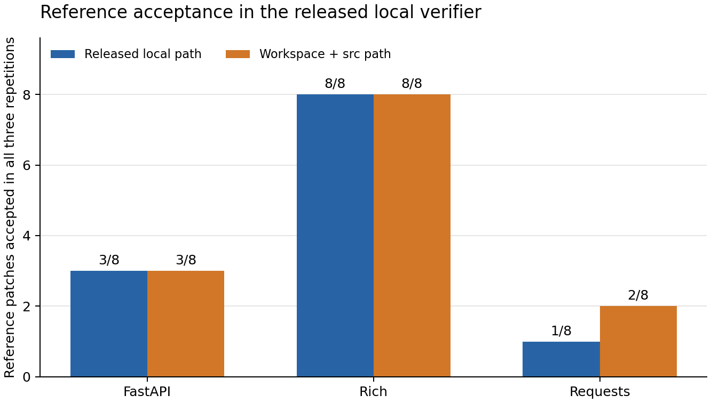

# Reference-Patch Acceptance in the Released Gemma 4 Local Verifier

**Subtitle:** A preregistered 24-task control audit with a fixed source-path intervention

**Author:** Akadri Oluseyi

## Abstract

Local coding-agent experiments depend on an executable path from a patch to
an acceptance decision. We audited whether the released Gemma 4 developer-agent
local subprocess verifier accepted its supplied reference patches. After
exploration on three excluded development tasks, we preregistered an audit of
24 tasks reserved for evaluation from FastAPI, Rich and Requests. We crossed
base/reference patches, released/workspace-plus-src execution paths, and three
fresh sandbox repetitions, completing all 288 controls. Twelve reference-control workflows were
unaccepted in all three released-condition repetitions: five FastAPI, zero Rich
and seven Requests tasks. The equal-repository non-acceptance estimate was 50.0%;
a conservative simultaneous 95% finite-pool sensitivity interval, conditional
on sampling and stability assumptions, was 26.5%–74.8%. A fixed source-path
overlay increased accepted references from 12 to 13 and reduced accepted bases
from one to zero. Every task/condition outcome was stable across repetitions.
Released Requests base/reference verdicts were identical on all eight tasks,
consistent with global-resolution probes; patch attribution is therefore limited.
The audit concerns the instrumented local path on one pinned Python 3.12 image.
It does not estimate Gemma's coding ability or establish defects in the hidden
scorer. The observed reference non-acceptance warrants calibration before
using this local path to interpret agent experiments; an import-path change
alone did not resolve most observed failures.

## Introduction

A coding-agent experiment measures more than patch generation. Its recorded
success also depends on repository restoration, dependency availability,
module resolution, test execution and the final acceptance rule. When a patch
is unaccepted, that outcome alone cannot identify which component prevented
acceptance. This matters when local feedback guides decisions about agent
budgets or implementation changes.

We ask a narrow question: does the released Gemma 4 developer-agent local
notebook verification path accept the competition's supplied reference patches
reproducibly? A supplied reference is an acceptance control, and an empty/base
patch provides a comparison. Neither is a semantic oracle: references can be
imperfect, and passing available tests does not establish complete correctness.

Our contribution is an executable control audit of one released local backend.
We preserve the verifier, freeze a metadata-selected task sample before
development outcomes, preregister the evaluation after disclosed exploration,
and retain failures and timeouts. A single fixed source-path intervention
provides a diagnostic comparison. We study the local SubprocessManager on a
pinned organizer image, with common measurement instrumentation in both arms.
The hidden Docker scoring backend and model-performance rankings are outside
the experiment.

## Related work

Ding et al. [1] re-execute coding-agent evaluations and examine whether changed
grading configurations alter accepted patches or fixed-history decisions. Their
reported negative and inconclusive results illustrate why an audit should state
which decisions and environments its evidence covers. Our experiment instead
uses supplied reference/base controls for a specific released local path; it
does not re-evaluate a leaderboard or an adaptive agent-search history.

EvalPlus [2] augments code-synthesis tests and demonstrates that test
insufficiency can change measured performance and rankings. We preserve the
released tests and measure their executable acceptance path. Sion and April [3]
separate software construction from assurance and study verification independent
of a builder. Our controls involve no main-study patch generation and make no
claim to introduce independent verification or calibration. The contribution
is the scoped observation and diagnostic comparison in this particular runtime.

## Methods

### Development and preregistration

An exploratory Gemma 4 E2B agent-budget pilot used three reserved development
tasks and produced no accepted patches in six runs. Subsequent base/reference
controls rejected all three development references. An additional 12-control
pilot crossed base/reference patches with the two source-path conditions: the
released path accepted no development reference, while the overlay accepted
one Requests reference. Development observations included a missing FastAPI
test dependency, Requests resolving to a globally installed package, and a Rich
reference passing pytest but failing a required-node check.

These observations motivated the present question. We abandoned the agent-budget
proposal before registration. The same 24 evaluation IDs had already been
selected from metadata; no evaluation-task verification outcome or agent output
had been generated or inspected. Both committed split manifests specify
`per_repo=8` and identical evaluation records; the archived pilot run-plan also
contains those same 24 IDs. Development observations were disclosed in
protocol P02, committed alone as `prereg:` commit
`52e0030deb8312c1c1d8abe804abfa6dbc2ae75b` before evaluation execution. The
protocol and implementation received Gemma E4B and 12B critiques; the original
`revise` verdicts and source/test adjudication are retained. These are
same-family reviews with limited independence. The accepted attestation records
the coding assistant's adjudication, not approval from either model.
No model generated or selected
a patch in the registered experiment.

### Population and fixed selection

The competition task file contained 129 records: 67 FastAPI, 48 Rich, 13
Requests and one HTTPX. We required at least nine tasks per repository to
reserve one development task and evaluate eight; HTTPX was consequently
excluded. Within each eligible repository, we ranked IDs by SHA256 of the fixed
salt `g4p-explicit-submission-v1`, a NUL byte and task ID, breaking ties by ID.
The first task was reserved for development and the next eight for evaluation.
No task was replaced based on its outcome.

The unit of analysis was the task. The finite target pools, excluding the
three development tasks, contained 66 FastAPI, 47 Rich and 12 Requests tasks.
We weighted repositories equally, rather than by their task-file frequencies.
Three repetitions measured the same task under fresh sandboxes; they did not
supply three independent task observations.

### Runtime and controls

We used the organizer's Python 3.12 image, pinned by digest, with swegemma
0.2.11, adk-submission 0.2.13 and adk-eval-core 0.1.0 from the supplied offline
wheelhouse. Kaggle hosted the notebook on four L4 GPUs, with
`enable_internet=false` in saved version-1 metadata; GPU inference was unused.
Configuration hashes and split-identity checks are in `paper/supporting-evidence.json`.
The released starter notebook supplies the organizer runtime context [4].

For each task, we crossed two patch states, two execution conditions and three
fresh sandbox repetitions: 24 × 2 × 2 × 3 = 288 assigned controls. Patch states
were an empty/base patch and the unmodified supplied reference. The official
verifier retained its protected-file stripping, verification-test patch,
pytest execution and JUnit/required-node checks.

The `released` manager set PYTHONPATH to the workspace root alone. The
`workspace_src` overlay replaced that value with `/workspace:/workspace/src`
for commands routed through the manager's `exec` method, using its existing
path translation. It did not append to an inherited value.
It added no dependency, changed no test or required-node metadata, and edited
no reference. Both arms included the same separate-process module-resolution
probe immediately before pytest, recording the module's file location. This
probe reports resolution in that process, not every import inside pytest.
The probe used `python3 -c`; verification used `python3 -s -m pytest` with
PYTHONSAFEPATH and PYTHONNOUSERSITE set to one. These flags limit direct
equivalence between probe and pytest imports.

Python Random(20261112) shuffled the complete control grid. At most two controls
ran concurrently, each with a fresh manager and output directory. Command,
verification and outer-control timeouts were 30, 120 and 180 seconds. The
registered job limit was two hours, with an absolute 21:45 UTC cutoff. No
case was retried, replaced or repaired after evaluation outcomes.

### Outcomes and uncertainty

Acceptance required the unchanged verifier to return `resolved=true`. The
primary task indicator was one only when a nonempty reference existed and
**zero of its three released-condition repetitions were accepted**. The primary
estimate was the mean of the three repository indicator proportions. A missing
reference would remain in the assigned denominator, be reported separately,
and not count as a rejected patch. None was missing.

The registered finite-sample existence hypothesis required at least one such
task, with all three controls attempted. Any lost, unattempted or globally
interrupted control would disable this decision. Individual timeouts and
exceptions represented non-acceptance within the workflow window, not semantic
incorrectness. Diagnostic categories distinguished collection errors, other
nonzero test exits, post-pytest rejection, missing references and outer exceptions.

For a finite-pool sensitivity interval, we inverted both hypergeometric tails
for each repository's population non-acceptance count, using two-sided marginal
alpha 0.05/3 (Bonferroni-adjusted across repositories), and averaged the lower
and upper proportion bounds. Conservative
simultaneous 95% coverage requires uniform sampling without replacement, stable
task outcomes and the idealized pseudorandom-hash sampling interpretation.
The interval is conditional on these assumptions. Overlay comparisons,
repository breakdowns, base acceptance and stability were descriptive; no
additional significance tests were introduced.

## Experiments and results

The private notebook completed all 288 controls in 3722.027 seconds
(approximately 62 minutes), starting at 18:17:53 UTC on 12 November 2026.
There were no missing references, lost cases, global interruptions or outer
exceptions. All individual row files matched the consolidated output. Every
reference/base outcome agreed across its three repetitions within each condition.

| Repository | Tasks | Released reference accepted | Overlay reference accepted | Released reference unaccepted in all three |
|---|---:|---:|---:|---:|
| FastAPI | 8 | 3 | 3 | 5 |
| Rich | 8 | 8 | 8 | 0 |
| Requests | 8 | 1 | 2 | 7 |
| Total | 24 | 12 | 13 | 12 |

The registered finite-sample hypothesis was supported: 12 of 24 provided
references were reproducibly unaccepted under the released condition.
The equal-repository estimate was (5/8 + 0/8 + 7/8)/3 = **50.0%**. Its conditional
finite-pool sensitivity interval was **26.5%–74.8%**, under the sampling and
stability assumptions above. This wide interval limits finite-pool precision;
it does not quantify behavior in other repositories or scoring backends.
The corresponding Bonferroni stratum bounds were FastAPI 21.2%–92.4%, Rich
0%–40.4% and Requests 58.3%–91.7% (98.33% marginal coverage under the assumptions).

Under the overlay, reference acceptance in all three repetitions rose from
12/24 (50.0%) to 13/24 (54.2%),
a gain of 4.2 percentage points. One Requests reference changed from unaccepted
to accepted; no reference changed the other way. Base acceptance changed from
1/24 under the released condition to 0/24 under the overlay. These paired
observations do not establish that an accepted base was semantically correct
or that the overlay repaired every relevant environment problem.

*Figure 1. References accepted in all three fresh-sandbox repetitions, out of
eight tasks per repository. Counts describe the fixed evaluation sample;
repetitions do not increase its size.*

Across 72 released reference repetitions, 36 were accepted, 12 ended in
collection errors and 24 in other nonzero test exits. Overlay counts were 39,
12 and 21, respectively. No reference passed pytest and was subsequently
rejected by the required-node check. The development Rich metadata rejection
therefore did not recur in the eight evaluation tasks: all eight Rich
references were accepted.

Twelve base controls hit the verification timeout: two Rich tasks under both
conditions in all three repetitions. They remain non-acceptances within the
registered window. No reference control hit that timeout. A descriptive,
post-analysis log extraction found the missing `inline_snapshot` diagnostic in
all 24 reference collection-error logs: four FastAPI tasks, both conditions,
three repetitions. Other nonzero exits were not adjudicated as semantic causes.

Requests resolution probes pointed outside the workspace for all 48 released
controls and inside it for all 48 overlay controls. The released probe origin
was `/usr/local/lib/python3.12/dist-packages/requests/__init__.py`, a system
installation rather than user site-packages. A post-registration
descriptive comparison found identical base/reference verdicts for all eight
released Requests tasks. Together, these observations are consistent with
testing the installed package rather than the patched checkout; they do not
establish every pytest import. The released base pass likewise does not
establish that the unpatched checkout satisfies the task. FastAPI and Rich probes
pointed inside the workspace in both conditions. Resolution changed as intended,
but reference acceptance improved on only one task. The results do not support
using source-path repair alone as a complete local calibration remedy.

## Limitations and conclusion

The question was generated by development observations; registration preceded
the untouched evaluation outcomes. The hypothesis is deliberately a
finite-sample existence claim, with no model-comparison p-value or estimate
of coding capability. A reference's rejection cannot distinguish an imperfect
reference, invalid test metadata, environment failure or grader defect.
Network unavailability under the offline configuration is another possible,
unadjudicated contributor to failures in network-dependent tests.
The hidden Docker scorer was not tested.

Only one pinned image and local backend were audited. Fresh sandboxes shared
one hosting setting; repetition agreement does not establish reproducibility
across hosts, dependency releases or Python versions. The shared import probe
could itself have import side effects, and we did not run a probe-free arm.
Its file-location observation is narrower than proof of all pytest imports.
The overlay changes command environments and their children, so its paired
acceptance change does not isolate every import or dependency mechanism.

The sample has eight tasks per repository, omits singleton HTTPX and weights
three repositories equally. The hash ordering is deterministic; the interval's
random-sampling interpretation is an explicit sensitivity assumption.
Provided references are controls rather than independently proved solutions,
and base acceptance is not a false-positive estimate against semantic truth.

Within this scope, half of the reference-control workflows were consistently
unaccepted, despite a complete and repetition-stable run. Requests' identical
released base/reference outcomes limit attribution to the supplied patches.
The source-path
intervention rescued one additional reference, leaving eleven unaccepted.
Before interpreting agent experiments through this local path, a useful next
step is a separately registered audit of environment construction and test
requirements. The present evidence motivates calibrating local feedback with
such controls; it does not correct a leaderboard or attribute failure to a model.

## Reproducibility and availability

The protocol and frozen execution source are identified by preregistration
commit `52e0030deb8312c1c1d8abe804abfa6dbc2ae75b`. The primary analysis ran from
that same commit with recorded execution and analysis dirty flags both false.
The curated result artifacts were subsequently committed as `dafa6a7`.
Authoritative experiment provenance is in `run-plan.json` and
`calibration-summary.json`; the checkpoint report's inherited
`code_commit=null` field does not identify the experiment code.
The private replication bundle contains the protocol, frozen metadata split,
container/dependency pins, source, tests, curated counts, figure and
installed-package versions, snapshot hashes and input/source digests.
Raw task records, reference patches and test source
are excluded; reproduction requires authorized competition access.
Additional configuration, split-identity and source checks are recorded in
`paper/supporting-evidence.json` (SHA256
`93ced73e277d24eccf7bc5545a4206d289701b292d1d5fc957cae675e75f686b`),
recorded in provenance commit `c68a0ee2a9ec6ae486acd9f5a9145f54039a0d85`.
The source task SHA256 is
`e4b3fd60f69dbc2b9213e54eeb9636db78aefe92c1d06269d73d9f5f8f3c8ad6`;
consolidated rows SHA256 is
`96c904176f1f4d6655b96ab88f48854407a0477bc387ee494989ce0c32750b0c`.
The pinned organizer image digest is
`sha256:37c64f7dd9c54116ecd1bcc88817c5469b88387388fade02bfa8bf3fc647d461`.

The analysis command is `python tools/analyze_calibration.py --run-directory
RUN_DIRECTORY --prereg-sha 52e0030deb8312c1c1d8abe804abfa6dbc2ae75b`, run through
the documented development container. `RUN_DIRECTORY` contains downloaded
`run-plan.json`, `rows.json` and `runtime-provenance.json`.
No public replication link is provided in this draft.

## References

1. Tianyu Ding, Yaocheng Tong, Muzhi Yang, Fei Jiang, Lei Yang and Boya Yu
   (2026). *Re-executing Coding-Agent Evaluations: Unchanged Decisions and
   Unresolved Policy Risk.* [arXiv:2610.14460](https://arxiv.org/abs/2610.14460).
2. Jiawei Liu, Chunqiu Steven Xia, Yuyao Wang and Lingming Zhang (2023).
   *Is Your Code Generated by ChatGPT Really Correct? Rigorous Evaluation of
   Large Language Models for Code Generation.* [arXiv:2305.01210](https://arxiv.org/abs/2305.01210).
3. Sion Israel Sion and Alain April (2026). *Who Verifies the Builder? Toward
   Independent Assurance for Agent-Produced Software.* [arXiv:2610.28667](https://arxiv.org/abs/2610.28667).
4. Ryan Holbrook (2026). *Getting Started - Gemma 4 Developer Agent.*
   [Version 3 source examined on 12 November 2026](https://www.kaggle.com/code/ryanholbrook/getting-started-gemma-4-developer-agent).
